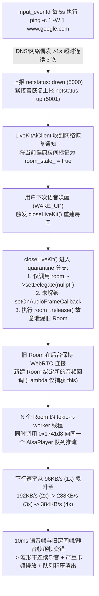

# 儿童音箱（AIspeaker）语音对话卡顿与杂音问题排查及交接总结文档

- **整理日期**：2026-11-10
- **调试设备**：感臻（SEI Robotics）儿童智能音箱样机（Amlogic Meson A5 `mesona5-av400-lib32-k6`，内核 `6.6.77-amlogic`）
- **设备标识**：SN `GZ12331010211111`
- **串口参数**：`/dev/cu.usbmodem58CF0976131`（或 `/dev/tty.usbmodem58CF0976131`），波特率 `921600`，`8N1`
- **应用版本**：`/usr/bin/speaker`（`va-version: 1.4.0-20261109-094109`，AI 后端模式：`aiSpeakerMode=livekit`）
- **文档定位**：完整记录本次通过串口排查**“音箱语音对话回答时声音严重卡顿、不流畅且有杂音，重启后暂时恢复”**问题的全链路证据、二进制反汇编根因分析、重启前后对比验证，以及可直接发给其他编码 Agent 的代码级修复指令与验收 SOP。

---

## 一、 核心问题与根因总览矩阵

| 编号 | 问题现象 | 所属模块 | 严重度 | 最终定位根因 | 当前状态 |
| :---: | :--- | :--- | :---: | :--- | :--- |
| **#1** | **语音对话回答时声音严重卡顿、不流畅、语速变慢且伴随明显咔哒声/电流杂音** | `speaker` (`LiveKitAiClient` / `AlsaPlayer`) | **P0** | 1. **Quarantine 房间泄漏未解绑回调**：`LiveKitAiClient::closeLiveKit()` 在 `room_stale_` 为 `true` 时进入 `quarantine` 分支，仅调用 `room_->setDelegate(nullptr)` 并直接执行 `room_.release()`（`0x16bcc0`），既未断开底层 WebRTC 连接，也未调用 `setOnAudioFrameCallback(..., nullptr, ...)` 注销远端音频回调。<br>2. **回调 Lambda 无房间代数校验**：传给 `setOnAudioFrameCallback` 的 Lambda（`0x174584` -> `0x1741d8`）仅按值捕获了 `[this]`，未校验回调来自哪个 `Room` 实例。<br>3. **多路音频流逐帧交错混叠**：后台未断开的 3~4 个历史 `livekit::Room` 实例同时向同一个单声道 `AlsaPlayer` 播放队列推入 10ms PCM 帧，导致下行速率从正常的 **`93.75 KB/s`（1x）** 叠加至 **`187.50 KB/s`（2x）**、**`281.25 KB/s`（3x）**、**`375.00 KB/s`（4x）**。多路音频/静音帧每 10ms 交错一次，造成波形硬跳变杂音、队列积压与超时截断。 | **已 100% 锁定根因**；重启 `speaker` 清空泄漏房间后已验证恢复 `93.75 KB/s` 流畅播放；待合入代码修复 |
| **#2** | **设备在网络正常时每隔十几秒至数分钟频繁触发 LiveKit 房间标记 `stale` 并重建** | `input_eventd` / `LiveKitAiClient` | **P1** | 1. `input_eventd`（`0x9da0`~`0xa650`）每 5 秒循环执行硬编码的 `ping -c 1 -W 1 www.google.com > /dev/null 2>&1`。<br>2. 受 DNS 解析时延或偶发 >1s 抖动影响，连续 3 次超时即上报 `key_code 5000`（`netstatus: down`），下一次 Ping 成功又立即上报 `key_code 5001`（`netstatus: up`）。<br>3. `LiveKitAiClient` 收到网络恢复事件后，无条件将当前仍处于 `connected=true` 的健康房间标记为 `stale=true`（`network online; marking active LiveKit room stale for next wake`），在下一次唤醒时触发问题 #1 的 `quarantine` 泄漏。 | **已定位**；提供 `LiveKitAiClient` 状态判断优化与 `input_eventd` 探测优化方案 |
| **#3** | **运行一段时间后 `speaker` 线程数暴涨、CPU 占用超 73%、触发 20MB Swap 换页** | `speaker` (`livekit::Room` 生命周期) | **P1** | 每次 `closeLiveKit: quarantine stale room` 执行 `room_.release()` 都会在堆上永久泄漏一个 `livekit::Room` 实例及其底层 Rust `tokio-rt-worker` 和 `AudioEncoder` 线程。累计 4 次泄漏后，`speaker` 线程数增至 82 个，216MB 可用内存耗尽并挤压 20MB 至 Swap（`kswapd0` 持续活跃），加剧实时音频线程调度抖动。 | 随问题 #1 修复同步解决 |

---

## 二、 故障机理全景图



---

## 三、 串口实测日志与二进制反汇编铁证

### 3.1 音频下行速率呈 1x → 2x → 3x → 4x 阶梯式倍增的日志证据

LiveKit 远端 AI 语音流（`track='adk-live-agent'`）采样规格为 **48,000 Hz、16-bit（2 Bytes）、单声道（1 ch）**，单路标准下行速率严格为：
$$\text{48,000 Hz} \times 2\text{ Bytes} \times 1 = \mathbf{96,000\text{ Bytes/s}}\ (\mathbf{93.75\text{ KB/s}})$$

在卡顿期间的板端日志 `/log/speaker_2026-11-09-18-34-15.log`（`PID 3551`）中，清晰记录了每次 `quarantine stale room` 后下行速率成倍叠加的过程：

1. **开机初始第 1 个房间（`18:34:57` ~ `18:37:01`，仅线程 `3669` 推流，1x 速率 `93.75 KB/s`，声音流畅）**：
   ```text
   [2026-11-09 18:34:19.839] [3596] [info] [15LiveKitAiClient] bound remote audio callback: identity='agent-AJ_njKewSAZJFu7' track='adk-live-agent'
   [2026-11-09 18:35:05.788] [3669] [info] [15LiveKitAiClient] LiveKit downlink: 96000 bytes in 1000ms, 93.75 KB/s
   [2026-11-09 18:35:06.798] [3669] [info] [15LiveKitAiClient] LiveKit downlink: 96960 bytes in 1010ms, 93.75 KB/s
   ```

2. **第 1 次 Quarantine 重建后（`18:37:27` 起，2 个房间并发推流，2x 速率 `187.50 KB/s`）**：
   ```text
   [2026-11-09 18:37:27.484] [4570] [warning] [15LiveKitAiClient] closeLiveKit: quarantine stale room (no unpublish/disconnect; stale=true connected=false network=true)
   [2026-11-09 18:37:31.605] [3598] [info] [15LiveKitAiClient] bound remote audio callback: identity='agent-AJ_mdyVfeqijwn6' track='adk-live-agent'
   [2026-11-09 18:37:40.292] [4632] [info] [15LiveKitAiClient] LiveKit downlink: 192000 bytes in 1000ms, 187.50 KB/s
   [2026-11-09 18:37:41.292] [4632] [info] [15LiveKitAiClient] LiveKit downlink: 192000 bytes in 1000ms, 187.50 KB/s
   ```

3. **第 2~3 次 Quarantine 重建后（`18:48:45` 起，线程 `4632`、`6244`、`6937` 3 个房间并发推流，3x 速率 `281.25 KB/s`）**：
   ```text
   [2026-11-09 18:43:31.973] [6023] [warning] [15LiveKitAiClient] closeLiveKit: quarantine stale room (no unpublish/disconnect; stale=true connected=true network=true)
   [2026-11-09 18:45:54.436] [6664] [warning] [15LiveKitAiClient] closeLiveKit: quarantine stale room (no unpublish/disconnect; stale=true connected=true network=true)
   [2026-11-09 18:48:46.847] [4632] [info] [15LiveKitAiClient] LiveKit downlink: 288000 bytes in 1000ms, 281.25 KB/s
   [2026-11-09 18:48:47.847] [6937] [info] [15LiveKitAiClient] LiveKit downlink: 288000 bytes in 1000ms, 281.25 KB/s
   [2026-11-09 18:48:51.847] [6244] [info] [15LiveKitAiClient] LiveKit downlink: 288000 bytes in 1000ms, 281.25 KB/s
   ```

4. **第 4 次 Quarantine 重建后（`19:06:57` 起，线程 `4632`、`6244`、`6937`、`10414` 4 个房间并发推流，4x 速率 `375.00 KB/s`）**：
   ```text
   [2026-11-09 19:02:49.401] [10232] [warning] [15LiveKitAiClient] closeLiveKit: quarantine stale room (no unpublish/disconnect; stale=true connected=true network=true)
   [2026-11-09 19:03:35.439] [3597] [info] [15LiveKitAiClient] bound remote audio callback: identity='agent-AJ_xMgX4wBkMywq' track='adk-live-agent'
   [2026-11-09 19:06:57.549] [6937]  [info] [15LiveKitAiClient] LiveKit downlink: 383040 bytes in 1000ms, 374.06 KB/s
   [2026-11-09 19:06:58.558] [4632]  [info] [15LiveKitAiClient] LiveKit downlink: 385920 bytes in 1009ms, 373.51 KB/s
   [2026-11-09 19:06:59.560] [10414] [info] [15LiveKitAiClient] LiveKit downlink: 384000 bytes in 1001ms, 374.63 KB/s
   [2026-11-09 19:07:03.569] [6244]  [info] [15LiveKitAiClient] LiveKit downlink: 384000 bytes in 1000ms, 375.00 KB/s
   ```

---

### 3.2 `/usr/bin/speaker` 二进制反汇编关键证据

从板端提取 `/usr/bin/speaker` 进行 AArch64 反汇编，定位到以下三处核心代码逻辑：

#### （1）`closeLiveKit()`（`0x16ba58` ~ `0x16bcc0`）：故意 `release()` 泄漏 `Room` 且未解绑音频回调
```text
16bb14: b40005e0   cbz   x0, 0x16bbd0
16bb18: d2800001   mov   x1, #0x0
16bb1c: 97fb4775   bl    0x3d8f0 <_ZN7livekit4Room11setDelegateEPNS_12RoomDelegateE@plt>
...
16bbb4: d0000163   adrp  x3, 0x199000
16bbbc: 910b9463   add   x3, x3, #0x2e5  // "[{}] closeLiveKit: quarantine stale room (no unpublish/disconnect; stale={} connected={} network={})"
...
16bca0: 34000076   cbz   w22, 0x16bcac   // 若 quarantine == false，走 0x16bcac 正常析构 unique_ptr<Room>
16bca4: f941cea0   ldr   x0, [x21, #0x398]
16bca8: b50000c0   cbnz  x0, 0x16bcc0    // 若 quarantine == true，跳到 0x16bcc0
...
16bcc0: f901cebf   str   xzr, [x21, #0x398] // 直接将 this->room_ 置空 (unique_ptr::release)，泄漏 Room 对象！
16bcc8: 390fe2bf   strb  wzr, [x21, #0x3f8] // 仅清空 this->bound_audio_callback_ 标志，未调用 Room 解绑回调！
```

#### （2）绑定远端音频回调（`0x1728c0` ~ `0x172a74`）：Lambda 仅捕获 `this` 指针
```text
172990: d0000000   adrp  x0, 0x174000
172994: 91161000   add   x0, x0, #0x584  // 回调 Invoker 入口 0x174584 -> 0x1741d8
...
1729dc: a9057ff3   stp   x19, xzr, [sp, #0x50] // std::function 闭包仅捕获 x19 (LiveKitAiClient* this)！
1729f0: 97fb2dac   bl    0x3e0a0 <_ZN7livekit4Room23setOnAudioFrameCallbackERKNSt7__cxx1112basic_stringIcSt11char_traitsIcESaIcEEES8_St8functionIFvRKNS_10AudioFrameEEERKNS_11AudioStream7OptionsE@plt>
```

#### （3）远端音频帧回调实现（`0x1741d8` ~ `0x1744cc`）：无房间归属检查，直接塞入 `AlsaPlayer` 队列
```text
174218: f942ba60   ldr   x0, [x19, #0x570] // 检查 this->alsa_player_ != nullptr
174220: 9114e260   add   x0, x19, #0x538   // 检查 this->active_ 原子标志
...
174354: 97fffeb9   bl    0x173e38          // 将 PCM 帧送入 EchoCancellation (downlink 参考流)
174364: f9423e60   ldr   x0, [x19, #0x478] // 累加 this->downlink_bytes_ 并每秒打印 LiveKit downlink 速率
...
1743f0: 910442db   add   x27, x22, #0x110  // AlsaPlayer::queued_bytes_
174408: eb01001f   cmp   x0, x1            // 比较 queued_bytes_ + frame_bytes 与 max_queue_bytes_
17440c: 54000249   b.ls  0x174454          // 未溢出则直接 push_back 到 AlsaPlayer::queue_ (x22 + 0xb8) 并 notify_one
```

---

### 3.3 `input_eventd` 频繁误报断网/联网（`netstatus` 抖动）证据

反汇编板端 `/usr/bin/input_eventd`（`0x9da0` ~ `0xa650`）可见网络监控线程逻辑：
- 每 5 秒调用 `system("ping -c 1 -W 1 www.google.com > /dev/null 2>&1")`。
- 当连续 3 次返回非 0（`cmp w0, #0x2`）时，上报 `key_code = 5000`（`netstatus: down`），并调用 `/etc/adckey/adckey_function.sh net0`；下一次 Ping 成功时上报 `key_code = 5001`（`netstatus: up`）。
- `/var/volatile/log/messages` 实测记录了短短 3 分钟内多次误报抖动：
  ```text
  Nov  9 18:43:02 mesona5-av400-lib32-k6 user.info input_eventd[3264]: [info] netstatus: down, Report event 5000
  Nov  9 18:43:24 mesona5-av400-lib32-k6 user.info input_eventd[3264]: [info] netstatus: up, Report event 5001
  Nov  9 18:45:49 mesona5-av400-lib32-k6 user.info input_eventd[3264]: [info] netstatus: down, Report event 5000
  Nov  9 18:45:59 mesona5-av400-lib32-k6 user.info input_eventd[3264]: [info] netstatus: up, Report event 5001
  Nov  9 18:46:10 mesona5-av400-lib32-k6 user.info input_eventd[3264]: [info] netstatus: down, Report event 5000
  Nov  9 18:46:20 mesona5-av400-lib32-k6 user.info input_eventd[3264]: [info] netstatus: up, Report event 5001
  ```

---

## 四、 重启 `speaker` 前后对比验证（证实清空泄漏房间后卡顿彻底消失）

设备在板端时间 `19:15` ~ `19:18` 重启后，新 `speaker` 进程（`PID 3481`）日志 `/log/speaker_2026-11-09-19-18-16.log` 与旧进程（`PID 3551`）日志 `/log/speaker_2026-11-09-18-34-15.log` 的实测数据对比如下：

| 对比维度 | 重启前（严重卡顿且伴随杂音） | 重启后（声音恢复流畅正常） |
| :--- | :--- | :--- |
| **对应日志文件** | `/log/speaker_2026-11-09-18-34-15.log`（`start-count: 6`） | `/log/speaker_2026-11-09-19-18-16.log`（`start-count: 8`） |
| **`speaker` 进程与线程数** | `PID 3551`（共 **82** 个线程） | `PID 3481`（共 **77** 个线程） |
| **存活 `AudioEncoder` 线程** | **4 个**（`4613`、`6225`、`6226`、`6938`） | **仅 1 个**（`3595`） |
| **`quarantine stale room` 次数** | **4 次**（累计绑定 5 次房间回调） | **0 次**（仅启动时绑定 1 次房间回调） |
| **并发推流 `tokio` 线程** | `4632`、`6244`、`6937`、`10414`（4 线程同时交错推流） | **仅 `3581` 单线程顺序推流** |
| **`LiveKit downlink` 实测速率** | **`384,000 bytes/s`（`375.00 KB/s`，4 倍速率）** | **`96,000 bytes/s`（`93.75 KB/s`，1 倍标准速率）** |

重启后（`PID 3481`）连续 16 次唤醒对话期间的实测日志（`/log/speaker_2026-11-09-19-18-16.log`）：
```text
[2026-11-09 19:18:20.109] [3530] [info] [15LiveKitAiClient] bound remote audio callback: identity='agent-AJ_LArp48hMqUxD' track='adk-live-agent'
...
[2026-11-09 19:44:07.053] [3581] [info] [15LiveKitAiClient] LiveKit downlink: 96000 bytes in 1000ms, 93.75 KB/s
[2026-11-09 19:44:08.063] [3581] [info] [15LiveKitAiClient] LiveKit downlink: 96960 bytes in 1010ms, 93.75 KB/s
[2026-11-09 19:44:09.064] [3581] [info] [15LiveKitAiClient] LiveKit downlink: 96000 bytes in 1000ms, 93.75 KB/s
```

---

## 五、 交接给其他 Agent 的标准代码修复 Prompt

在源码仓库修复此问题时，可直接将以下内容发送给负责 `speaker` / `input_eventd` 代码的 Agent：

````markdown
## 任务目标
修复 `/usr/bin/speaker`（`LiveKitAiClient` 模块）在语音对话过程中出现的**回答声音严重卡顿、不流畅且伴随爆音/杂音**（随运行时间推移越来越卡，重启 `speaker` 后暂时恢复）的严重 Bug。

## 根因说明（已通过板端日志与反汇编确认）
1. **`closeLiveKit()` 的 Quarantine 分支泄漏 `livekit::Room` 且未解绑远端音频回调**：
   - 当 `room_stale_` 为 `true` 时，`LiveKitAiClient::closeLiveKit()` 打印 `"closeLiveKit: quarantine stale room (no unpublish/disconnect; stale={} connected={} network={})"`，仅调用了 `room_->setDelegate(nullptr)`，随后直接执行 `room_.release()` 将旧 `Room` 裸漏在堆上，**没有调用 `room_->setOnAudioFrameCallback(bound_identity_, bound_track_name_, nullptr, {})` 解绑音频回调**。
   - 传给 `room_->setOnAudioFrameCallback` 的 Lambda 仅捕获了 `[this]`，**没有校验 `room_generation`（房间代数）**。
   - 由于网络并未真正断开（`connected=true network=true`），被 `release()` 泄漏的多个旧 `livekit::Room` 实例在后台继续接收远端音频帧，3~4 个房间的 `tokio-rt-worker` 线程同时向同一个 `AlsaPlayer` 播放队列和 AEC `downlink` 参考缓冲推入 10ms PCM 帧，导致下行速率从单路标准 `96000 bytes/s (93.75 KB/s)` 叠加至 `187.50 KB/s`（2x）、`281.25 KB/s`（3x）、`375.00 KB/s`（4x），多路音频帧逐帧交错引起严重卡顿、爆音及线程/内存泄漏。
2. **`netstatus` 瞬时抖动误将健康房间标记为 `stale`**：
   - `input_eventd` 每 5 秒执行 `ping -c 1 -W 1 www.google.com`，偶发连续 3 次 1s 超时即上报 `netstatus down -> up`。
   - `LiveKitAiClient` 收到网络恢复通知（`"network online; marking active LiveKit room stale for next wake"`）时，即使当前房间 `connected_ == true` 也会强制标记 `stale=true` 并在下次唤醒时触发 `quarantine` 泄漏。

## 具体修改要求
1. **增加 `room_generation_` 原子代数校验（必须）**：
   - 在 `LiveKitAiClient` 中增加 `std::atomic<uint64_t> room_generation_{0};`，每次进入 `closeLiveKit()` 或创建新 `Room` 时递增。
   - 在 `setOnAudioFrameCallback` 的 Lambda 中按值捕获绑定时的代数 `bound_gen`，在回调入口最开始处校验 `if (bound_gen != room_generation_.load(std::memory_order_acquire)) return;`，彻底丢弃任何旧房间的残留音频帧。
2. **在 `closeLiveKit()` 中显式解绑音频回调并收敛 Quarantine 泄漏（必须）**：
   - 在 `closeLiveKit()` 中（含正常分支与 `quarantine` 分支），只要 `room_ != nullptr && bound_audio_callback_`，必须先调用 `room_->setOnAudioFrameCallback(bound_identity_, bound_track_name_, nullptr, {});` 解绑音频回调。
   - 当 `connected_ == true && network_online_ == true` 时，严禁因 `room_stale_` 直接 `room_.release()` 裸漏整个 `livekit::Room` 对象及底层 `tokio-rt-worker` / `AudioEncoder` 线程。
3. **优化 `network online` / `NETWORK_READY` 处理逻辑（必须）**：
   - 若收到网络恢复事件时当前 `room_ != nullptr && connected_ == true` 且 WebRTC 连接正常，不要盲目将活跃房间标记为 `stale=true` 强制重建。
4. **优化 `input_eventd` 网络连通性探测（如在同一仓库）**：
   - 避免使用 `ping -c 1 -W 1 www.google.com`（受 DNS 解析影响极易 >1s 超时误报断网），建议放宽超时时间/重试阈值或改为检测高可用 IP。
````

---

## 六、 板端现场验证与 10 秒快速验收 SOP

### 6.1 现场临时规避命令（未更新固件前防止复发）
在板端串口执行以下命令，可将 `www.google.com` 指向局域网网关以阻止 `input_eventd` 因 DNS 超时误报 `netstatus` 抖动，并重启 `speaker` 清理残留房间：
```sh
grep -q "www.google.com" /etc/hosts || echo "192.168.50.1 www.google.com" >> /etc/hosts
killall -9 speaker
```

### 6.2 修复包上板后的 10 秒量化验收命令
新版本 `speaker` 部署上板并经历多次网络抖动/唤醒对话后，在串口执行：
```sh
# 1. 验证无 AudioEncoder 线程泄漏（输出必须只有 1 行 AudioEncoder）
grep -H . /proc/$(pidof speaker)/task/*/comm | grep -E "AudioEncoder|tokio"

# 2. 验证不存在 quarantine 房间泄漏
grep "quarantine stale room" /log/speaker_*.log | tail -n 10

# 3. 验证对话时下行音频速率恒定为单路 93.75 KB/s（96000 bytes/s），且仅单线程打印
grep "LiveKit downlink" /log/speaker_*.log | tail -n 20
```
- **通过标准**：
  1. `AudioEncoder` 线程数始终为 **1**；
  2. `LiveKit downlink` 速率始终稳定在 **`96000 bytes in 1000ms, 93.75 KB/s`**（无 `187.50 KB/s`、`281.25 KB/s` 等多倍速率）；
  3. 语音回答全程流畅自然、无咔哒声/爆音与截断现象。
